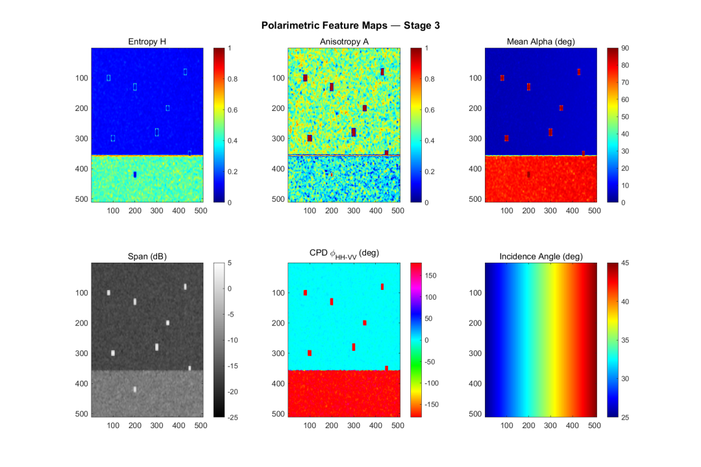
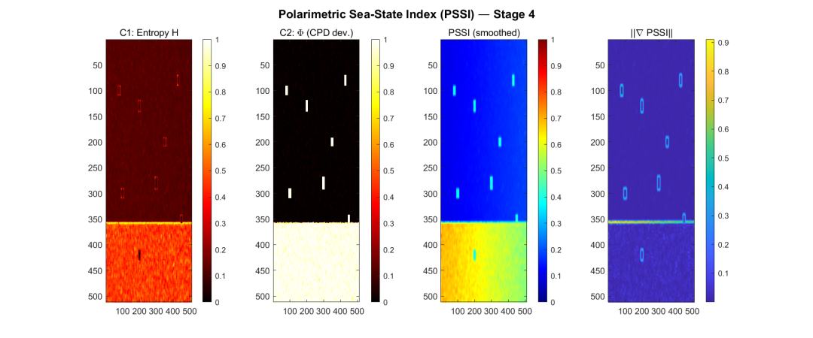
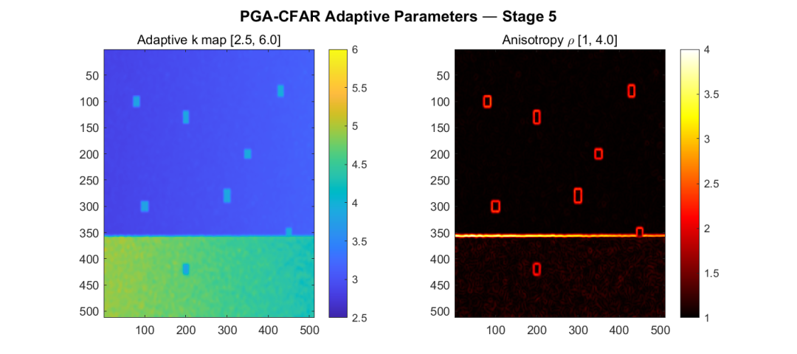
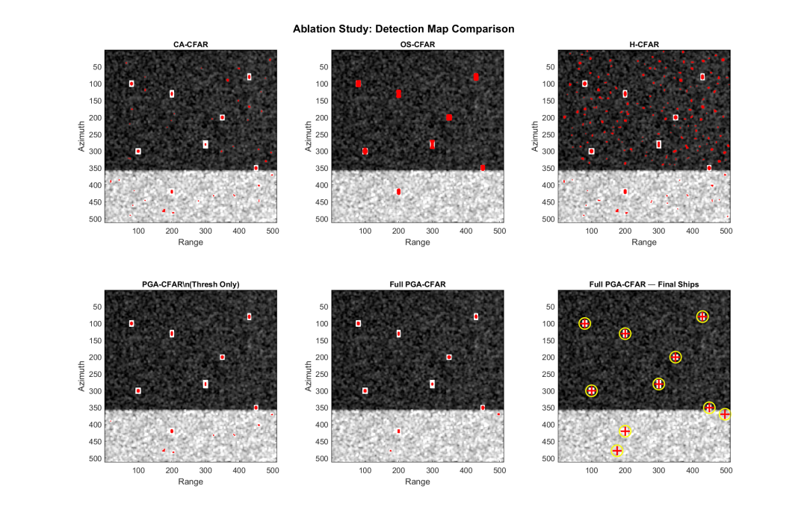

# How radars intelligently "see" ships amidst sea surface changes? The clever design of PGA-CFAR [with MATLAB code]

Sea Surface Condition Influences Radar Target Detection: A Glimpse into the Art of PGA-CFAR Design
As the sea conditions change from calm to rough, traditional radar target detection methods often become "blinded"—either missing real ships or misidentifying waves as targets. Today, we delve into an open-source work by the VIT Chennai team that has equipped a CFAR detector with "sea condition perception" eyes and transformed the detection window into a deformable ellipse.
Why is it so challenging to "find a ship at sea"? Synthetic Aperture Radar (SAR) is a powerful tool for monitoring naval vessels at sea, but its observations are not uniform. Changes in wind and waves dramatically alter the surface roughness, which manifests as fluctuating clutter statistics in radar images.

Traditional constant false alarm rate (CFAR) detectors have a fatal assumption: the background clutter is uniform. Thus, they use a fixed-size square window to estimate local clutter intensity and then use a fixed threshold coefficient k to judge the target. Once the window crosses the boundary between smooth and rough sea surfaces, it mixes two entirely different types of clutter, leading to either missed detection due to the threshold being raised or excessive false alarms caused by the threshold being lowered.

Is there a method that allows the detector to know its current sea state and proactively adjust the threshold and window shape?

The first innovation: Installing a "Sea State Index" on the Radar - The PSSI research team proposed a Polarimetric Sea-State Index (PSSI). It does not rely on external data such as wind speed or wave height but calculates continuous values from 0 to 1 directly from full polarimetric SAR data, depicting the degree of sea surface roughness at each pixel.

PSSI integrates three physically meaningful and orthogonal polarimetric features:
Entropy H: Measuring the randomness of scattering. On calm seas, Bragg scattering dominates, resulting in low entropy; when waves break and foam increase, the scattering mechanism becomes complex, raising entropy.
The total polarization phase difference Φ: It characterizes the phase relationship between the HH and VV channels. Under ideal Bragg scattering, the phase difference is approximately 0°; as the sea surface becomes more rough, it deviates further from the Bragg model, approaching ±180°.
Brahms ratio deviation ΔB: The normalized deviation of the measured HH/VV power ratio from the theoretical prediction under Bragg scattering.
Weighted sum of the three:
PSSI(m,n) = 0.4×H + 0.3×Φ + 0.3×ΔB
The most brilliant aspect of this formula is that ship targets do not generate high PSSI. Ships are mostly two-dimensional scattering, although Φ and ΔB are large, but the entropy H is very low (scattering mechanism is single and coherent), and the weight of entropy is precisely set to be maximum (0.4). Thus, the PSSI value of ships is suppressed at an intermediate level, far below the actual high sea state area. PSSI thus becomes a "sea-specific" roughness indicator, rather than a generalized anomaly detector.
💡 Inspiration: Use a physically meaningful blending index to describe environmental conditions, and leverage the inherent differences in target and background on a certain dimension (here, low entropy) to avoid the pollution index itself—this is a graceful self-supervised design for environmental perception.
Second innovation: With PSSI, there's a continuous map of local sea conditions. Next, researchers did something even more groundbreaking: made the CFAR window adaptive elliptical.
The idea is this: Sea surface clutter is not isotropic. On the wave propagation direction, sea roughness changes dramatically; while along the wave crests, statistical characteristics are roughly uniform. In ideal conditions, we should only collect background pixels from "similar sea states."
They calculated the gradient direction and magnitude of PSSI. The gradient direction is approximately vertical to the wave crests, pointing towards the direction of wave propagation. Based on this, the elliptical window was designed as follows:
Long axis (along the wave crests) elongated - to include as many statistically uniform pixels as possible;
Short axis (along the wave propagation direction) compressed - to avoid crossing into another sea state area.
The degree of ellipse stretching is determined by the PSSI gradient magnitude, and the window automatically reverts to a circle (traditional CFAR) when the sea state is calm. At locations with dramatic changes in sea conditions, the ellipse's length-to-width ratio can reach 4:1. The ellipse area remains constant, so the number of pixels involved in the estimation remains constant, eliminating concerns about statistical stability.
At the same time, the threshold coefficient k for CFAR is no longer a global fixed value but dynamically changes with the PSSI: it automatically decreases in calm seas to maintain sensitivity to weak targets, and increases in rough seas to suppress clutter false alarms.
This is the complete PGA-CFAR (PSSI-Guided Adaptive CFAR): adaptive threshold × adaptive ellipse window × polarization prescreening.
💡 Inspiration: Utilizing the structural information of the scene itself (gradient field) to dynamically distort the support domain of the processing operator, ensuring that the algorithm operates under the assumption of "local stationarity." This "geometric adaptive" idea can be perfectly transferred to other non-uniform scene image analysis tasks.
How does it work? A team conducted an ablation experiment on synthetic full polarimetric SAR scenes, hiding 8 known-positioned simulated ships within the scene and setting up calm/rough sea areas and transition zones.
Take key data:
Detector
Detection rate Pd
False alarm pixel count
False alarm rate Pfa
CA-CFAR (traditional)
75%
324
0.00124
Full PGA-CFAR 100%
890.00034

The detection rate increased from 75% to 100%, with none of the 8 ships missed.
The false alarm rate dropped by 72.6%, with only about one-fourth of the traditional method's false alarm pixel count.
Under the same detection rate (87.5%), the PGA-CFAR required a false alarm rate only 1/48 of that of CA-CFAR.
The ablation experiment also revealed that simply switching to adaptive thresholds could enhance performance. However, when combined with an adaptive ellipse window, the most challenging ship to detect, precisely located in the transition zone between sea conditions, was successfully rescuedâ€"this is precisely the power of the ellipse window to avoid the mixing of boundary clutter.
Additionally, polarization pre-screening (retaining only pixels with scattering angle α > 40° and entropy H < 0.6) directly eliminated about 93% of the candidate points, significantly reducing computational load and blocking the source of false targets.
05 Beyond Detection: What Can We Learn? PGA-CFAR is not just a set of useful algorithms; its design philosophy inspires researchers in remote sensing, radar, and even general object detection.
1  
Prior knowledge-driven, not data-driven weighting and thresholds are set based on the electromagnetic scattering model, independent of any training samples. It is applicable to zero-shot transferring to C-band and L-band satellites.
2  
The essence of the Multi-Dimensional Information Interference (MDI) fusion PSSI lies in its ability to balance three features, leveraging the "weakness" of low entropy on ships to naturally obscure targets in environmental indices, eliminating the need for explicit target elimination steps.
3  
The support domain of the operator follows the scene structure, and an ellipse window is equivalent to a "structurally-aware" local neighborhood that always points towards the direction with the least clutter statistics. This idea can be generalized to any situation where local statistical estimation is required and the scenario involves directional gradients.

## Images

<!-- PAYMENT_BLOCK -->

## Get this dataset

- Payment link (Stripe): [Buy now](https://buy.stripe.com/3cs8yP7sY87d0vu9AB)
- Payment QR code: 

<!-- /PAYMENT_BLOCK -->
